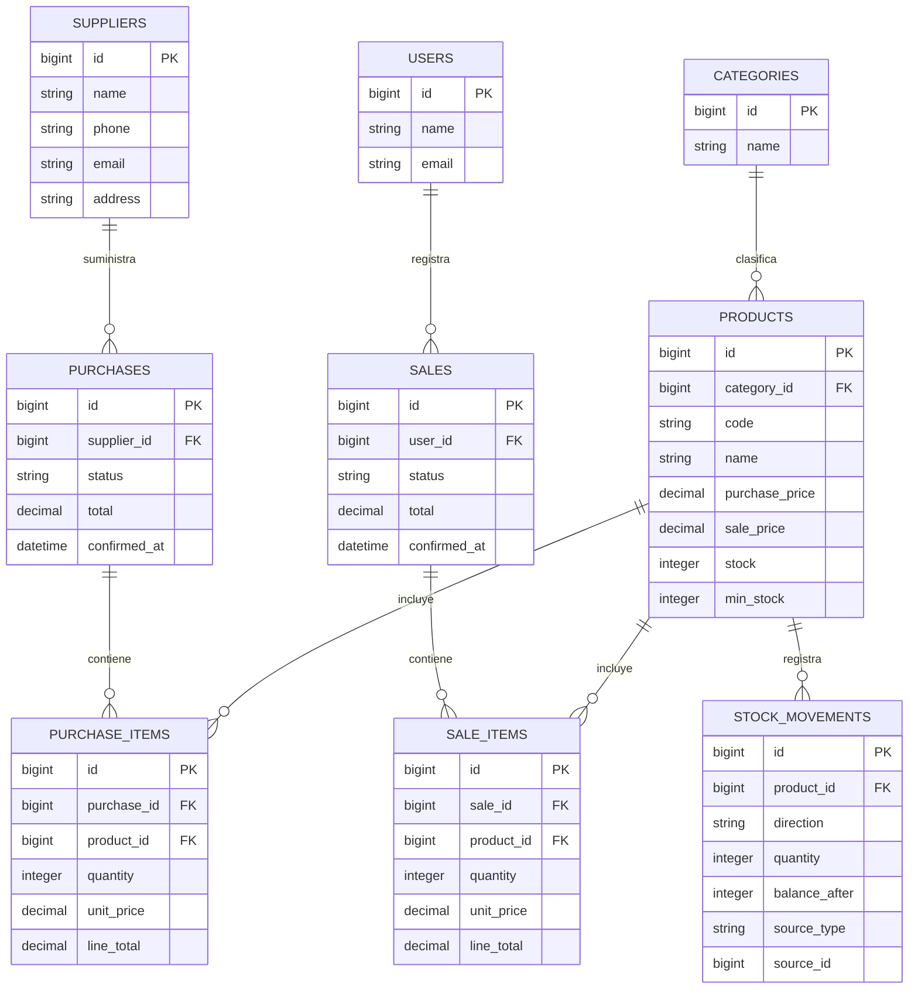

# Diagrama entidad-relación de FarmaGest

Modelo de datos compartido para el proyecto. Debe actualizarse si cambian las migraciones antes de la entrega.

Nota: stock_movements.source_type y source_id son referencias lógicas a detalles de compra o venta, no claves foráneas físicas. Sus reglas de unicidad se aplican mediante índice y InventoryService.
